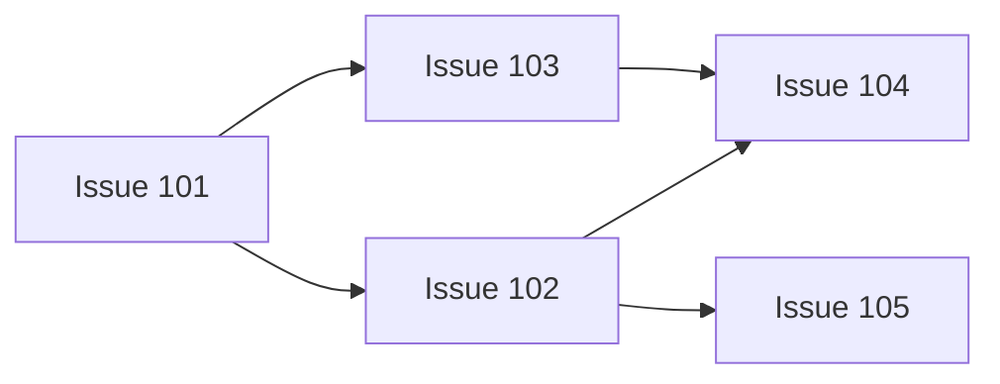

# Invocation Examples

The repositories, paths, and Issue numbers below are illustrative. Resolve
actual inputs from the user's current request. Creating this skill does not
execute any example.

## Fork, Join, And Independent Progress



Equivalent normalized input:

```yaml
repository: example/project
project_path: /absolute/path/to/project
base_branch: dev
mode: dry-run
max_parallel: 3
child_model: gpt-6.1-sol
child_thinking: medium
failure_policy: continue_independent
nodes:
  - issue: 101
    depends_on: []
  - issue: 102
    depends_on: [101]
  - issue: 103
    depends_on: [101]
  - issue: 104
    depends_on: [102, 103]
  - issue: 105
    depends_on: [102]
```

Initially, only 101 is ready. After its verified completion, 102 and 103 may
start. If 102 completes while 103 is still running, 105 may start immediately.
104 still waits for both 102 and 103. If 103 becomes blocked, 104 cannot start;
105 can continue under `continue_independent`.

## Chinese Request

```text
使用 $guru-orchestrate-issue-dag。
仓库 example/project，本地项目 /absolute/path/to/project，以 dev 为基线。
依赖关系：101 -> 102，101 -> 103，102 -> 104，103 -> 104，102 -> 105。
最多并行 3 个 Issue，子 chat 使用 gpt-6.1-sol / medium。
先做 dry-run，展示依赖图、首批可启动节点、完成条件和具体副作用。
```

For a live request, the human can specify `mode=auto` and explicitly ask the
coordinator to create per-Issue chats/worktrees, start a heartbeat, and send
follow-up instructions. They can also delegate the listed Git/GitHub actions
within each Issue, specifying whether merge, release, deployment, and exact
resource cleanup are included. These are human conversation instructions, not
fields to persist in the skill input or automation configuration. Missing
authority is resolved after the concrete read-only plan is available.
Resolve that choice before creating children or a heartbeat. A current human
request that already covers the actions needs no repeat question. Full Issue
completion is the goal; only an explicit human stage limit narrows the current
execution segment. The coordinator does not invent a PR-only endpoint.
The selected `dev` base applies to worktree creation, PR targets and merge-result
reachability. A stale unrelated `main` needs no fast-forward or exemption.

## Other Graph Shapes

- Serial: `101 -> 102 -> 103`; `max_parallel: 1` also limits any graph to one
  admitted unfinished node at a time.
- Independent: three nodes with `depends_on: []`; admit up to the slot limit.
- Multiple roots and join: `101 -> 103`, `102 -> 103`; 103 waits for both roots.
- Resource exclusion: `exclusive_groups: [[102, 103]]` prevents those Issues
  occupying slots together without specifying their dependency order.
- Release: attach an override to the release Issue with the exact expected
  tag, published Release, packages/assets, and smoke requirements. Downstream
  nodes wait for the complete release proof, not just its code merge.

For behavioral regression inputs and expected observations, read
`tests/forward-cases.md` from canonical source. Those source-only tests are not
part of the installed runtime and never authorize execution of their examples.

## Cross-Repository Nodes With Different Bases

```yaml
repositories:
  example/api:
    project_path: /absolute/path/to/api
    base_branch: dev
  example/web:
    project_path: /absolute/path/to/web
    base_branch: main
nodes:
  - repository: example/api
    issue: 7
    depends_on: []
  - repository: example/web
    issue: 7
    depends_on: [example/api#7]
  - repository: example/web
    issue: 8
    depends_on: []
max_parallel: 2
mode: dry-run
```

`example/api#7` and `example/web#7` are distinct nodes. Web #8 may run
independently; web #7 waits for API #7’s full completion on API’s `dev`.
Each child uses its repository’s actual saved project and primary folder.
The coordinator and provider can be in a third repository. Do not create
anything during this dry-run.

## Frontend Starts From An API Contract

```yaml
repositories:
  example/api:
    project_path: /absolute/path/to/api
    base_branch: dev
  example/mobile:
    project_path: /absolute/path/to/mobile
    base_branch: main
  example/web:
    project_path: /absolute/path/to/web
    base_branch: main
nodes:
  - repository: example/api
    issue: 21
    depends_on: []
  - repository: example/mobile
    issue: 22
    depends_on: []
    contract_dependencies:
      - provider: example/api#21
        contract: https://github.com/example/api/issues/21#issuecomment-123456789
        work: Profile screen requests, responses and error states
  - repository: example/web
    issue: 23
    depends_on: []
    contract_dependencies:
      - provider: example/api#21
        contract: https://github.com/example/api/issues/21#issuecomment-123456789
        work: Profile page requests, responses and error states
max_parallel: 3
mode: dry-run
```

Suppose API #21 is still implementing, but its current contract specifies the
profile interface sufficiently for both consumers. The ready set includes all
three Issues. In a covered live run, instruct Mobile #22 and Web #23 to use
contract-based Mock interface data and proceed while API #21 continues. No API
merge, Issue closure or deployed endpoint is needed for this start condition.

If the profile read interface is usable but the update error behavior is still
missing, start the read work and hold only the affected update work. On each
heartbeat reread the actual contract, request a concrete missing detail from
the existing provider owner where permitted, and continue the same frontend
owners when that detail becomes usable. Keep routine coordination quiet.

If Web #23 also has `depends_on: [example/api#21]`, that explicit completion
edge still holds Web #23 until API #21 fully completes. Do not silently replace
it with a contract prerequisite. If that edge conflicts with the stated intent
to wait only for the contract, resolve that specific discrepancy first.
With one execution slot and API #21 running, ready frontend work waits for a
normal slot release; contract readiness does not increase concurrency.

The equivalent Chinese request is:

```text
Mobile #22 和 Web #23 仅依赖后端 #21 的可用接口合同。
合同足以支持的部分立即用 Mock 接口数据开发，与后端并行推进；
合同缺口只暂停受影响部分，不等待后端实现完成、部署或上线。
```

## Initiative And Missing Environment

```text
显式使用 $guru-orchestrate-issue-dag，先 dry-run。
读取动议 https://github.com/example/product/issues/42 的正式成员绑定和职责，
从当前权威解析成员及依赖。产品总控负责最终验收，工程项消费已经就绪的需求。
相关资料链接不自动进入本轮集合。每仓读取自己的 Codex 项目与默认基线。
```

Read the actual initiative before deriving a graph. A product requirement
being ready and that control Issue’s final acceptance are different obligations;
references to ready requirements do not create a cycle with final acceptance.

If web has no local project, inspect current creation/UI capabilities and
permissions. Dry-run reports the exact gap. In a covered live run, use a
supported creation entry and reread primary repository/remote/base. If none is
available, give current user steps to register the correct checkout and primary
folder. If App trust is required, the user reviews it; the Agent never clicks
or edits trust. Configure setup only for a demonstrated runtime prerequisite.
With `continue_independent`, ready API work can continue while web and its
descendants wait. After the user supplies the missing condition, reread the
same bindings and resume this run, preserving any existing children.
