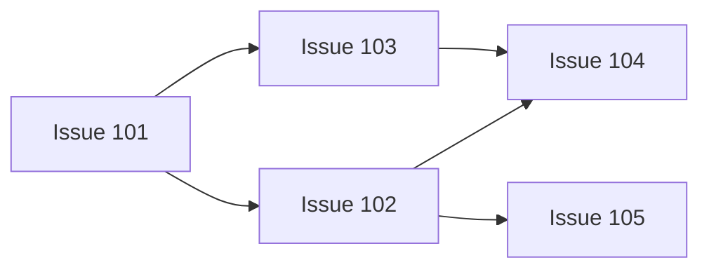

# Invocation Examples

The repositories, paths, and Issue numbers below are illustrative. Resolve
actual inputs from the user's current request. Creating this skill does not
execute any example.

## Fork, Join, And Independent Progress



Equivalent normalized input:

```yaml
repository: example/project
project_path: /absolute/path/to/project
mode: dry-run
max_parallel: 3
child_model: gpt-6.1-sol
child_thinking: medium
failure_policy: continue_independent
nodes:
  - issue: 101
    depends_on: []
  - issue: 102
    depends_on: [101]
  - issue: 103
    depends_on: [101]
  - issue: 104
    depends_on: [102, 103]
  - issue: 105
    depends_on: [102]
```

Initially, only 101 is ready. After its verified completion, 102 and 103 may
start. If 102 completes while 103 is still running, 105 may start immediately.
104 still waits for both 102 and 103. If 103 becomes blocked, 104 cannot start;
105 can continue under `continue_independent`.

## Chinese Request

```text
使用 $guru-orchestrate-issue-dag。
仓库 example/project，本地项目 /absolute/path/to/project。
依赖关系：101 -> 102，101 -> 103，102 -> 104，103 -> 104，102 -> 105。
最多并行 3 个 Issue，子 chat 使用 gpt-6.1-sol / medium。
先做 dry-run，展示依赖图、首批可启动节点、完成条件和具体副作用。
```

For a live request, the human can specify `mode=auto` and explicitly ask the
coordinator to create per-Issue chats/worktrees, start a heartbeat, and send
follow-up instructions. They can also delegate the listed Git/GitHub actions
within each Issue, specifying whether merge, release, deployment, and exact
resource cleanup are included. These are human conversation instructions, not
fields to persist in the skill input or automation configuration. Missing
authority is resolved after the concrete read-only plan is available.
Resolve that choice before creating children or a heartbeat. A current human
request that already specifies the endpoint and actions needs no repeat
question. The coordinator's own proposed endpoint is not a human choice.

## Other Graph Shapes

- Serial: `101 -> 102 -> 103`; `max_parallel: 1` also limits any graph to one
  admitted unfinished node at a time.
- Independent: three nodes with `depends_on: []`; admit up to the slot limit.
- Multiple roots and join: `101 -> 103`, `102 -> 103`; 103 waits for both roots.
- Resource exclusion: `exclusive_groups: [[102, 103]]` prevents those Issues
  occupying slots together without specifying their dependency order.
- Release: attach an override to the release Issue with the exact expected
  tag, published Release, packages/assets, and smoke requirements. Downstream
  nodes wait for the complete release proof, not just its code merge.

For behavioral regression inputs and expected observations, read
`tests/forward-cases.md` from canonical source. Those source-only tests are not
part of the installed runtime and never authorize execution of their examples.
